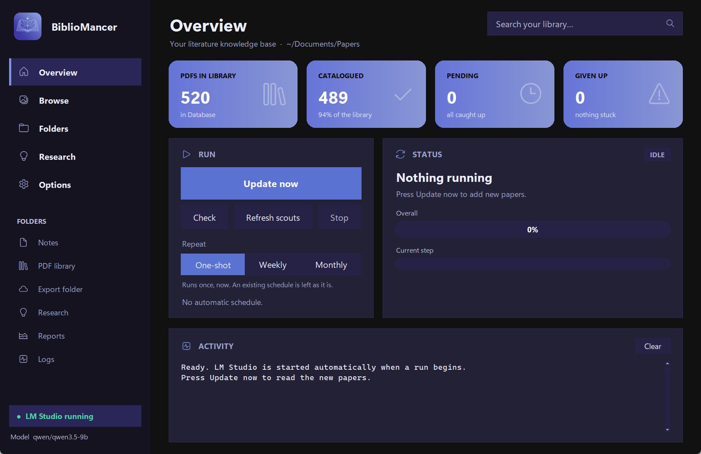

# 1. Install and first run

## LM Studio and the models

BiblioMancer uses [LM Studio](https://lmstudio.ai) (free) to run the AI models on your
own computer.

1. Install LM Studio and open it once.
2. In **Discover**, download:
   - a chat model — the default is **`qwen/qwen3.5-9b`** (it has vision, so scanned PDFs
     can be read too). About 8 GB; comfortable on a GPU with 12 GB of memory.
   - the embedding model **`nomic-embed-text-v1.5`** (84 MB), for search by meaning.

You do not need to load the models or start the server yourself: BiblioMancer does it
before every run, with the right settings.

## Install BiblioMancer

Pick one (details in the [README](../../README.md#install)):

- **Windows**: run `BiblioMancer-<version>-Setup.exe`. No administrator rights needed.
  Tick *Create a desktop icon* if you want one; the Start-menu entry is on by default.
- **macOS**: open the `.dmg` and drag BiblioMancer to Applications. The first time,
  right-click the app → Open (the build is not signed by Apple).
- **Linux**: make the AppImage executable (`chmod +x`) and run it.
- **Python**: `pipx install git+https://github.com/matteomarchionni/bibliomancer`, then
  `bibliomancer`.

## The setup window

On first launch a short setup window asks for three folders:

| Folder | What for |
|---|---|
| **Your PDF library** | Where your papers are (subfolders are fine). Only ever read. |
| **Data folder** | Notes (Markdown), the database, caches, reports. Keep it on a local disk — not inside Google Drive / OneDrive, whose sync can lock the database mid-run. |
| **Synced export folder** (optional) | Rewritten after every run with an export for AI agents and a full backup. A cloud folder is ideal here. |

It also checks LM Studio and the model (with a *Download LM Studio* button if something is
missing), and — except after the Windows installer, which already asked — offers a
desktop icon and a menu entry.

Press **Start**. The control panel opens on the **Overview** page.

## A tour of the panel

- **Overview** — four tiles (PDFs in the library, catalogued, pending, given up), the
  **Run** card, the **Status** card with two progress bars, and the activity log.
- **Browse**, **Folders**, **Research** — search and research, covered in tutorials 3–4.
- **Options** — maintenance (report, check setup, rebuild…), ingest options, model and
  folders, appearance.
- The sidebar's **Folders** section opens your notes, library, export, research, reports
  and logs folders directly.

Next: [your first update](02-first-update.md).
